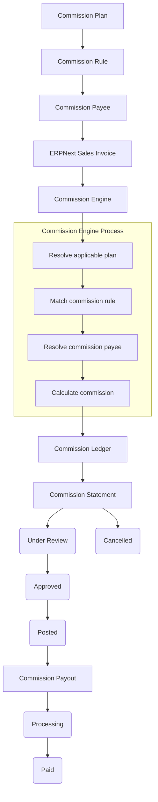
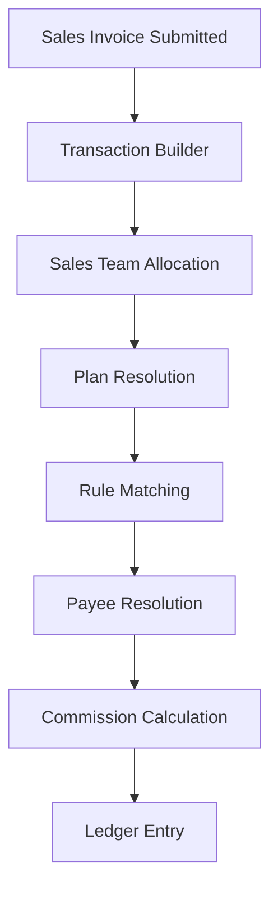
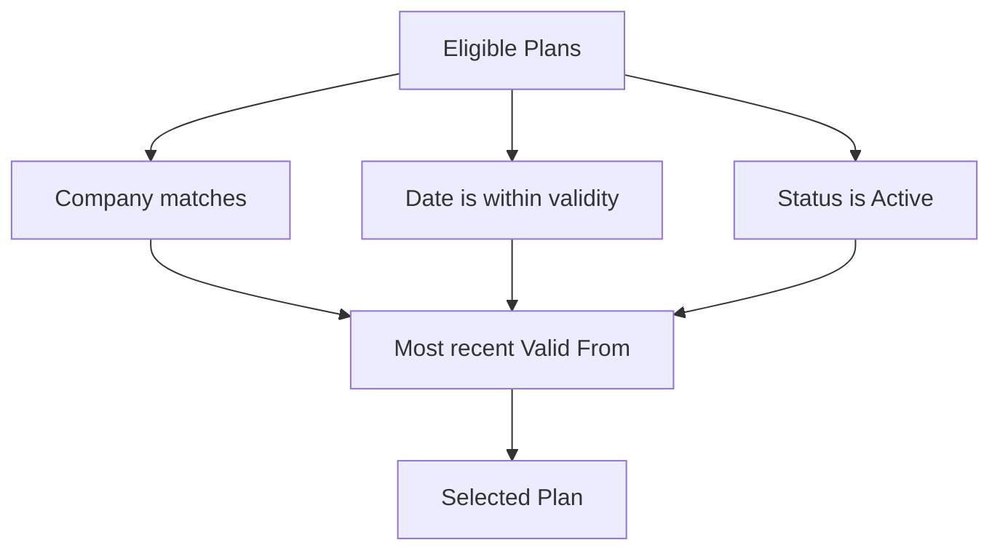
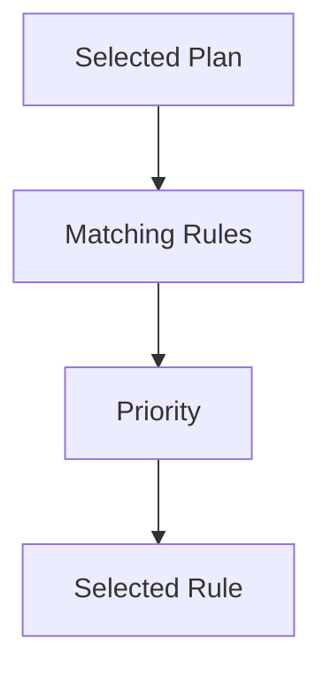
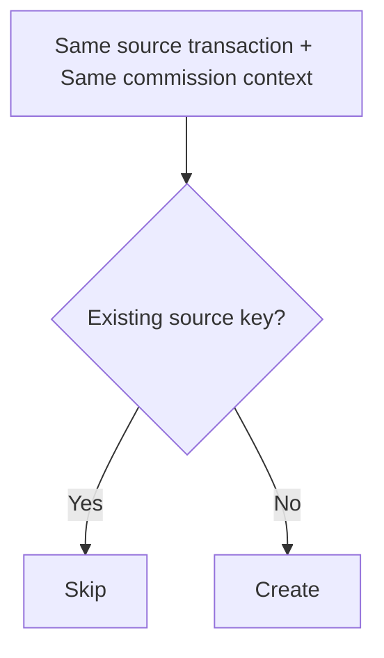
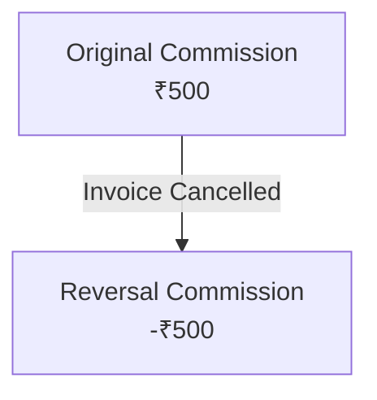
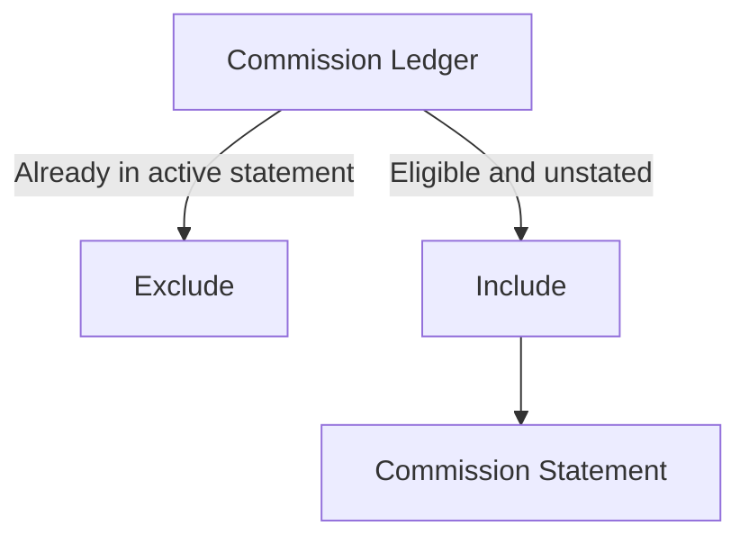
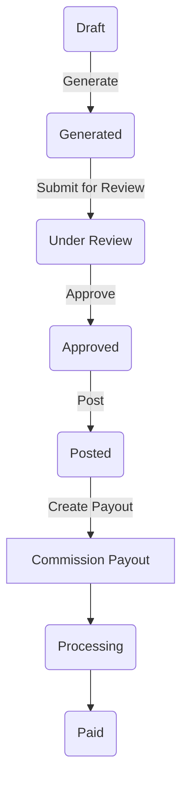

# Concepts Overview

The ERPNext Incentive Compensation Engine separates commission configuration, calculation, historical records, statement processing, and payout processing into distinct components.

This separation keeps the commission lifecycle understandable and makes historical calculations auditable.

## How the System Fits Together

At a high level:



There are two important parts to this lifecycle:

1. **Calculation** — turning an ERPNext sales transaction into a commission ledger entry.
2. **Settlement** — grouping eligible ledger entries into statements and moving approved commission through payout.

## Core Components

### Commission Plan

A **Commission Plan** defines the company, currency, validity period, and status for a set of commission rules.

A plan answers:

> **Which commission configuration is applicable for this transaction?**

The engine considers active plans for the relevant company and transaction date. When multiple applicable plans exist, the plan with the most recent `Valid From` date is selected.

See [Commission Plans](commission-plans.md).

---

### Commission Rule

A **Commission Rule** defines when a commission applies and how the commission is calculated.

Rules can be matched using:

- Item
- Item Group
- Sales Person
- Customer
- Customer Group
- Territory

Supported calculation methods are:

- Percentage
- Fixed Amount
- Tiered

Rules also have a priority. Lower priority numbers are evaluated first when multiple rules match.

A rule answers:

> **Does this transaction qualify, and what calculation should be applied?**

See [Commission Rules](commission-rules.md).

---

### Commission Payee

A **Commission Payee** represents the person or partner who receives commission.

A payee can be associated with:

- an ERPNext Sales Person, or
- an ERPNext Sales Partner.

The payee abstraction allows the commission system to consistently identify the recipient across ledger entries, statements, and payouts.

See [Commission Payees](commission-payees.md).

---

### Commission Ledger

The **Commission Ledger** is the historical record of calculated commissions.

A ledger entry stores the result of the calculation, including information such as:

- Sales Invoice
- Sales Invoice Item
- Commission Payee
- Commission Plan
- Commission Rule
- Calculation Method
- Base Amount
- Rate
- Fixed Amount
- Commission Amount
- Transaction Date
- Calculation Date
- Source Key
- Entry Type
- Status

Ledger entries are immutable historical records.

> **Important:** Later changes to a commission plan or rule do not rewrite an existing Commission Ledger entry.

The ledger is therefore the source from which commission statements are built.

See [Commission Ledger](commission-ledger.md).

---

### Commission Statement

A **Commission Statement** groups eligible Commission Ledger entries for a specific payee, company, currency, and date range.

A statement contains:

- Commission Payee
- Company
- Currency
- From Date
- To Date
- Gross Commission
- Adjustments
- Net Commission
- Generation Date
- Status
- Ledger Entries

A new statement starts as a **Draft**.

After it is generated, the selected ledger entries and calculated totals form an immutable statement snapshot.

The statement then moves through the review and approval lifecycle.

See [Commission Statements](commission-statements.md).

---

### Commission Payout

A **Commission Payout** represents the actual payment process for a posted Commission Statement.

A payout contains information such as:

- Commission Statement
- Commission Payee
- Company
- Currency
- Amount
- Payment Date
- Payment Reference
- Status

A payout progresses through:


Failed payouts can be returned to processing, while pending or processing payouts can be cancelled where permitted.

See [Commission Payouts](commission-payouts.md).

## From Transaction to Commission

The calculation path begins with an ERPNext Sales Invoice.

When the invoice is submitted, the commission event handler starts the commission calculation flow.



### Sales Team Allocation

The transaction builder evaluates the Sales Team on the Sales Invoice.

When multiple Sales Team members are present, the invoice item's commission base can be allocated according to each member's contribution percentage.

For example:

```text
Invoice Item Amount     ₹10,000

Sales Person A            60%
Sales Person B            40%

Allocated Base A          ₹6,000
Allocated Base B          ₹4,000
```

The resulting allocated base amounts are then evaluated against the commission configuration.

## Plan Resolution

Plan resolution determines which Commission Plan should govern the transaction.

The relevant conditions include:

- Company
- Transaction date
- Plan status
- Plan validity period

When multiple active plans are applicable, the engine selects the one with the most recent `Valid From` date.



Only rules belonging to the selected plan are then considered.

## Rule Matching

After the plan is selected, the engine evaluates the rules belonging to that plan.

A rule can apply to a particular:

- Item
- Item Group
- Sales Person
- Customer
- Customer Group
- Territory

If multiple rules match, priority determines which rule is selected.



This keeps plan selection and rule selection as two separate decisions.

## Commission Calculation

The selected rule determines the calculation method.

### Percentage

```text
Commission = Base Amount × Rate / 100
```

Example:

```text
Base Amount = ₹10,000
Rate        = 5%

Commission  = ₹10,000 × 5 / 100
            = ₹500
```

### Fixed Amount

A fixed commission uses the configured fixed amount rather than a percentage of the transaction value.

### Tiered

A tiered rule uses configured commission tiers based on the transaction amount.

The final tier can have no upper limit by leaving its `To Amount` empty.

The calculation engine uses decimal arithmetic for commission calculations to avoid relying on binary floating-point arithmetic for financial values.

See [Calculation Engine](../development/calculation-engine.md).

## Historical Records and Idempotency

The system treats the Commission Ledger as a historical record rather than a recalculatable view.

Each generated commission has a unique source key.

This provides idempotency:



This prevents duplicate commission entries when the same event is processed more than once.

## Cancellation and Reversals

Cancelling a submitted Sales Invoice does not modify the original commission ledger entry.

Instead, the system creates a reversal entry.



The original entry remains available as part of the audit history.

The reversal is linked to the original commission context and uses its own source key so the reversal operation is also idempotent.

See [Reversals](../workflows/reversals.md).

## Statement Eligibility

A statement does not recalculate commissions.

Instead, it selects eligible Commission Ledger entries matching:

- Commission Payee
- Company
- Currency
- Date range
- Eligible ledger status

Entries that have already been included in another non-cancelled statement are excluded.

This means the ledger remains the calculation record while the statement becomes the settlement snapshot.



## Statement and Payout Lifecycle

Once a statement has been generated, it moves through the review lifecycle:



The statement and payout workflows intentionally separate:

- calculation
- review
- approval
- posting
- payment

See:

- [Commission Lifecycle](../workflows/commission-lifecycle.md)
- [Statement Workflow](../workflows/statement-workflow.md)
- [Payout Workflow](../workflows/payout-workflow.md)

## Design Principles

The system is built around a few core principles.

### Configuration is separate from history

Plans, rules, and payees define how commissions should be calculated.

Ledger entries preserve what was actually calculated.

### Historical calculations are immutable

Changing a plan or rule should affect future calculations, not rewrite historical results.

### Calculation is separate from settlement

The Commission Ledger records calculation results.

Statements group those results for review and approval.

Payouts track the actual payment.

### Events stay thin

ERPNext document events trigger commission processing, but the calculation logic lives in the commission engine rather than inside the event handlers.

This keeps the integration layer small and the core logic easier to test.

### Financial state transitions are explicit

Statements and payouts move through controlled workflow transitions rather than allowing arbitrary status changes.

### The system is auditable

The combination of immutable ledger entries, statement snapshots, payout records, source keys, and reversal entries provides a traceable path from a Sales Invoice to a paid commission.

## Where to Go Next

If you are learning the system from the beginning:

1. [Commission Plans](commission-plans.md)
2. [Commission Rules](commission-rules.md)
3. [Commission Payees](commission-payees.md)
4. [Commission Ledger](commission-ledger.md)
5. [Commission Statements](commission-statements.md)
6. [Commission Payouts](commission-payouts.md)

If you are interested in how the application is implemented:

1. [Architecture](../development/architecture.md)
2. [Calculation Engine](../development/calculation-engine.md)
3. [Events](../development/events.md)
4. [Testing](../development/testing.md)
5. [Contributing](../development/contributing.md)
