<!-- File: testing.md -->

# Testing

The ERPNext Incentive Compensation Engine uses multiple layers of testing to verify commission calculations, configuration resolution, historical ledger behavior, workflows, reports, and the integration with ERPNext Sales Invoices.

The testing approach separates low-level calculation tests from higher-level integration and end-to-end tests.

## Testing Strategy

The main testing layers are:

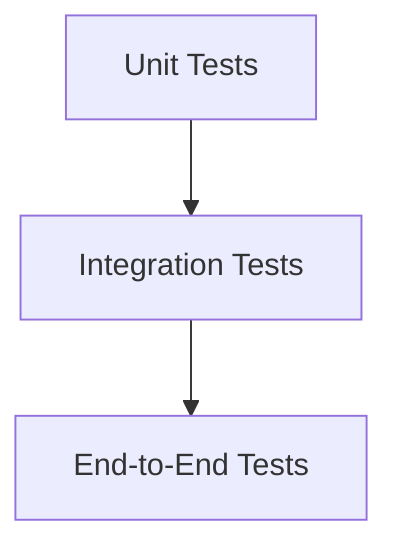

Each layer answers a different question.

| Test Layer  | Main Question                                                                  |
| ----------- | ------------------------------------------------------------------------------ |
| Unit        | Does an individual calculation or function behave correctly?                   |
| Integration | Do multiple application components work together correctly?                    |
| End-to-End  | Does the complete commission lifecycle work from source transaction to payout? |

## Test Structure

Application tests are located under the application's test directories.

The tests cover areas such as:

- commission calculations
- rule resolution
- commission ledger behavior
- statements
- payouts
- reports
- end-to-end commission workflows

When adding a new feature, tests should be added at the lowest appropriate layer first and then expanded to integration or end-to-end coverage when the feature crosses component boundaries.

## Running the Test Suite

From the Frappe Bench directory, the application test suite can be run with:

```bash
bench --site <your-site> run-tests --app incentive_compensation
```

For example:

```bash
bench --site acme-electronics.localhost run-tests --app incentive_compensation
```

The command asks Frappe to discover and run the tests belonging to the application.

## Test Environment

Tests should run against a Frappe site with the application installed.

A dedicated development or test site is preferable to a production site.

For example:

```text
incentive-test.localhost
```

A clean or isolated site is especially useful for integration and end-to-end testing because ERPNext data and configuration can affect test behavior.

## Unit Testing

Unit tests verify focused pieces of business logic without requiring the entire commission lifecycle.

The calculation layer is particularly suitable for unit testing because its functions can operate on explicit inputs and return calculated values.

### Calculation Tests

Calculation tests should cover:

- percentage commissions
- fixed commissions
- tiered commissions
- tier boundaries
- open-ended final tiers
- decimal arithmetic
- Sales Team allocation

A simple percentage calculation can be tested with:

```text
Base Amount = ₹10,000
Rate = 5%

Expected Commission = ₹500
```

The test should verify the calculated value directly.

## Percentage Tests

A percentage test should verify the basic formula:

```text
Commission = Base Amount x Rate / 100
```

Example:

```text
Base Amount = ₹20,000
Rate = 10%

Expected = ₹2,000
```

Boundary and decimal values should also be tested where appropriate.

## Fixed Amount Tests

A fixed amount test verifies that the configured fixed commission is returned correctly.

Example:

```text
Fixed Amount = ₹500

Expected Commission = ₹500
```

The test should also verify that unrelated transaction amount changes do not incorrectly turn the fixed calculation into a percentage calculation.

## Tiered Commission Tests

Tiered calculations require more boundary coverage.

Tests should verify:

- values inside a tier
- values at the lower boundary
- values at the upper boundary
- values between tiers
- the final open-ended tier
- multiple tier configurations

For example:

```text
From       To         Rate
₹0         ₹10,000    2%
₹10,000    ₹20,000    3%
₹20,000    blank      5%
```

Tests should explicitly exercise the boundaries instead of testing only a value in the middle of a tier.

## Sales Team Allocation Tests

Sales Team allocation should be tested independently of the final commission calculation.

Example:

```text
Transaction Amount = ₹20,000

Sales Person A = 70%
Sales Person B = 30%
```

Expected bases:

```text
A = ₹14,000
B = ₹6,000
```

This verifies that transaction preparation produces the correct inputs for subsequent commission calculation.

## Resolver Tests

The resolver is responsible for finding applicable commission configuration.

Tests should cover:

- active plans
- inactive plans
- plan validity dates
- multiple applicable plans
- newest applicable `valid_from`
- rule matching
- rule priority
- enabled and disabled rules
- tier resolution
- payee resolution

### Plan Selection

For multiple applicable plans, the test should verify that the plan with the most recent applicable `valid_from` is selected.

Conceptually:

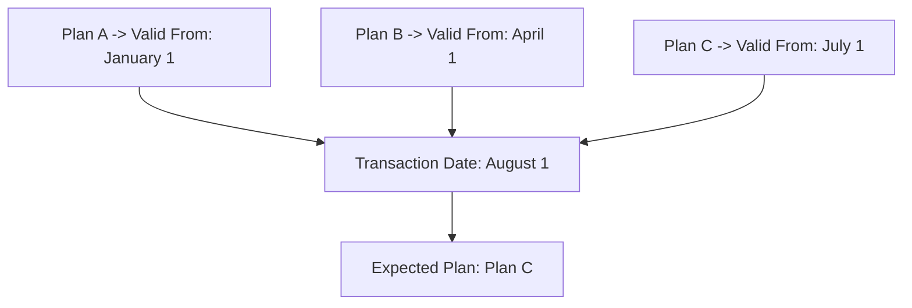

This is important because plan selection determines which rules are evaluated.

## Rule Matching Tests

Rule matching should verify each supported condition.

Examples include:

```text
Item
Item Group
Sales Person
Customer
Customer Group
Territory
```

Tests should include both matching and non-matching transactions.

A rule that does not match should not generate a commission.

## Rule Priority Tests

When multiple rules can match, tests should verify that priority produces the intended result.

For example:

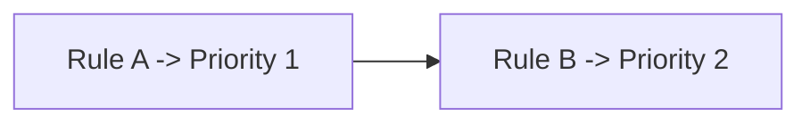

If both rules match, the rule with the lower priority number is evaluated first.

The test should verify that the expected rule is selected.

## Ledger Tests

The Commission Ledger is the historical boundary of the calculation system.

Ledger tests should cover:

- successful creation
- required source information
- source key generation
- duplicate prevention
- immutability
- reversal creation
- reversal references

### Idempotency Test

A commission calculation should not create duplicate ledger entries when the same source calculation is processed again.

Conceptually:

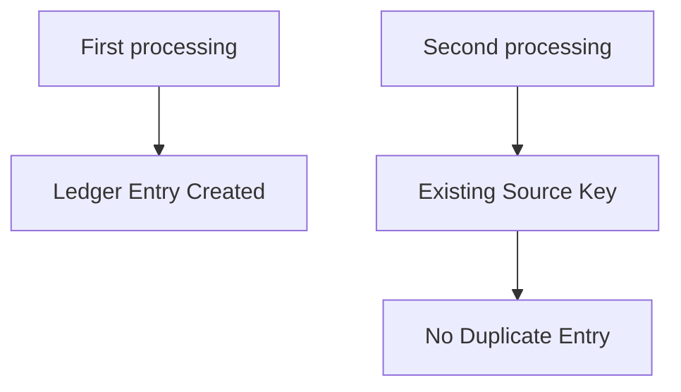

The test should verify that only one historical commission entry exists for the same source calculation.

## Ledger Immutability Tests

Historical ledger records should not be freely modified after creation.

Tests should verify that protected calculation fields cannot be changed after the entry exists.

The important principle is:

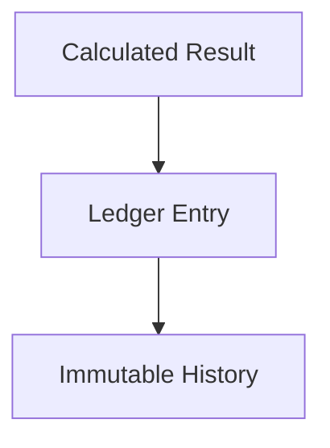

This protects the audit trail.

## Reversal Tests

When a source Sales Invoice is cancelled, the original commission entry should remain unchanged and a reversal entry should be created.

A reversal test should verify:

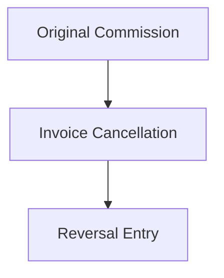

The reversal should:

- represent the opposite financial effect
- reference the original commission through `reversal_of`
- use the appropriate reversal entry type

## Statement Tests

Statement tests should cover both generation and workflow behavior.

Important areas include:

- creating a Draft statement
- finding eligible ledger entries
- excluding entries already included in another non-cancelled statement
- calculating gross commission
- calculating adjustments
- calculating net commission
- creating the ledger-entry snapshot
- setting the generation date
- moving the statement through its workflow
- protecting generated statement data

## Statement Generation Test

A basic statement generation test can use:

```text
Commission Ledger
₹500

Statement
Payee = Same Payee
Date Range = Includes Ledger Date
```

Expected:

```text
Gross Commission = ₹500
Adjustments      = ₹0
Net Commission   = ₹500
```

The generated statement should contain the corresponding Commission Statement Entry.

## Statement Eligibility Tests

Statement resolution should verify that ledger entries are selected only when they match:

- Commission Payee
- Company
- Currency
- date range
- eligible ledger status

Ledger entries already included in another non-cancelled statement should be excluded.

Cancelled statements do not permanently consume the underlying ledger entries.

## Statement Immutability Tests

Once a statement has been generated, its historical calculation data should be protected.

Tests should verify that users cannot freely change:

- Commission Payee
- Company
- Currency
- From Date
- To Date
- Gross Commission
- Adjustments
- Net Commission
- Generation Date

The statement's ledger-entry snapshot should also be protected from ordinary modification.

## Statement Workflow Tests

Statement workflow transitions should be explicitly tested.

The intended lifecycle is:

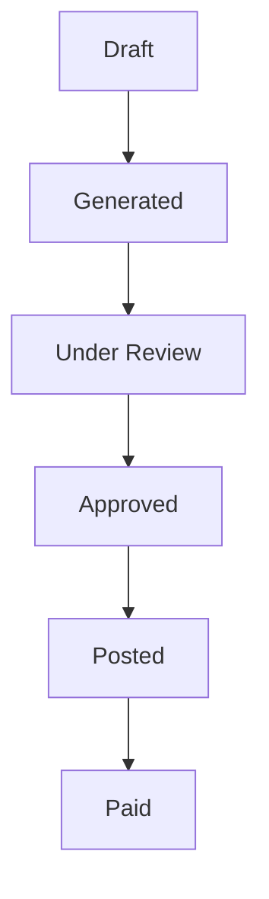

Generation is separate from the approval workflow.

The workflow should also allow the appropriate cancellation transitions.

Tests should verify that invalid direct transitions are rejected.

For example, a statement should not be able to jump directly from:

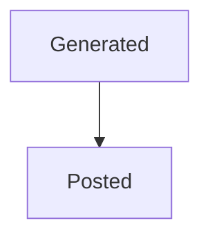

without going through the required review and approval stages.

## Payout Tests

Payout tests should cover:

- creation from a Posted statement
- payout amount
- duplicate payout prevention
- payout workflow
- required payment information
- marking a payout as Paid
- updating the associated statement to Paid

The intended payout lifecycle is:

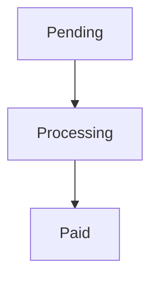

A payout can also move through the appropriate Failed and Cancelled states.

## Payout Creation Test

A Posted statement with a positive net commission should produce a payout.

Example:

```text
Statement Net Commission = ₹500

Expected Payout Amount = ₹500
```

The payout should reference the source statement and payee.

## Payout Validation Tests

A payout should not be marked as Paid without the required payment information.

The payment process requires:

- Payment Date
- Payment Reference

Tests should verify each validation independently.

For example:

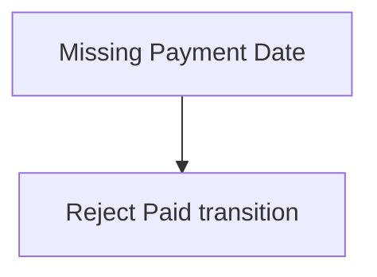

and:

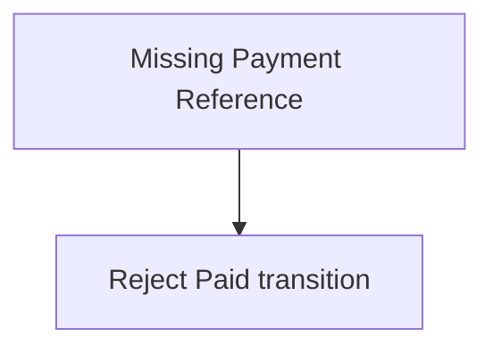

## Payout and Statement Synchronization

When a payout is successfully marked as Paid, the associated Commission Statement should also become Paid.

This relationship should be covered by integration tests.

Expected behavior:

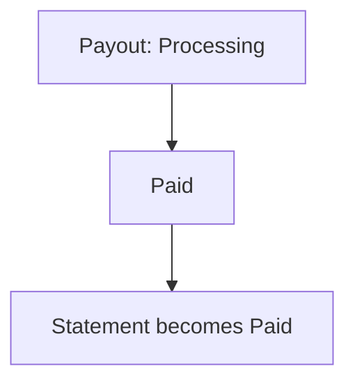

## Report Tests

The application provides six reports:

- Commission Summary
- Commission by Payee
- Commission by Plan
- Commission by Rule
- Commission by Invoice
- Commission by Date

Report tests should verify that the correct Commission Ledger records are included and that filters produce the expected results.

Important filters include:

- Company
- From Date
- To Date
- Commission Payee
- Commission Plan
- Commission Rule
- Sales Invoice

Commission by Date uses the date range to determine the reporting period.

## Integration Testing

Integration tests verify that multiple application components work together.

Examples include:

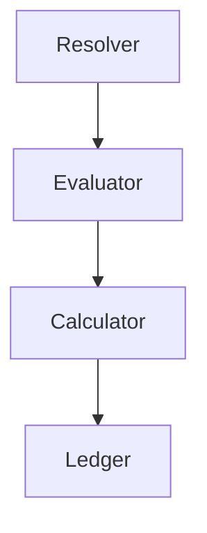

and:

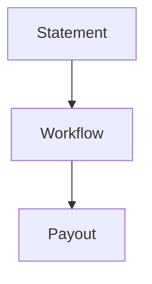

Integration tests are particularly useful when a feature crosses module boundaries.

## Sales Invoice Integration Test

A key integration test verifies that a submitted ERPNext Sales Invoice produces a commission ledger entry.

The expected flow is:

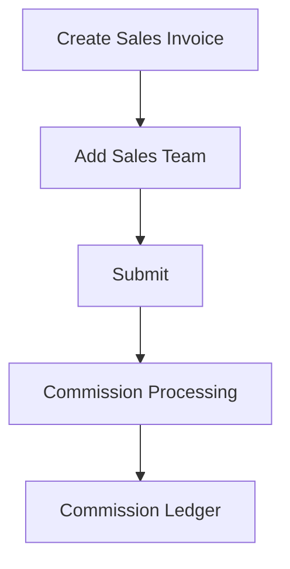

The test should verify the resulting ledger information, including:

- Sales Invoice
- Commission Payee
- Commission Plan
- Commission Rule
- Base Amount
- Commission Amount
- Transaction Date

## Sales Invoice Cancellation Integration Test

The cancellation path should verify:

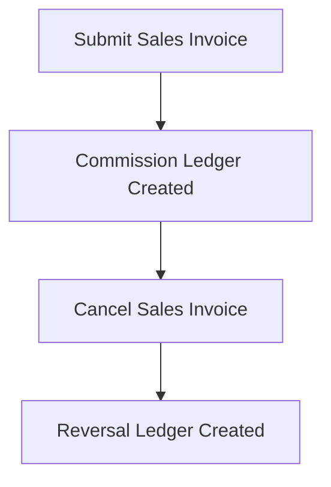

The original ledger entry should remain intact.

## End-to-End Testing

End-to-end testing verifies the complete commission lifecycle.

A complete scenario should cover:

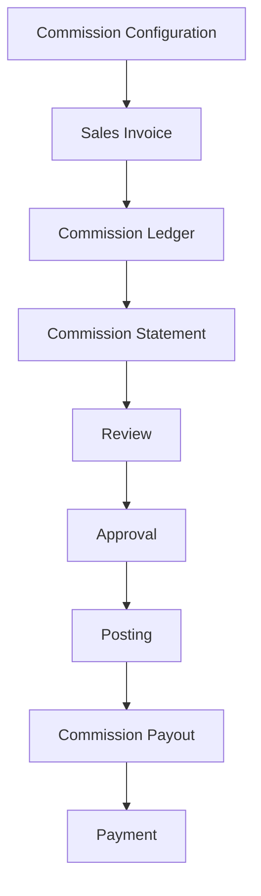

This verifies that the major application components work together as a real user workflow.

## Example End-to-End Scenario

A representative test can use:

```text
Company: Incentive Test Company
Plan: Standard Sales Commission
Rule: Demo Item Commission
Payee: Test Salesperson
Item: Test Item
Sales Invoice Amount: ₹10,000
Rate: 5%
```

Expected commission:

```text
₹10,000 x 5%
= ₹500
```

The test then verifies:

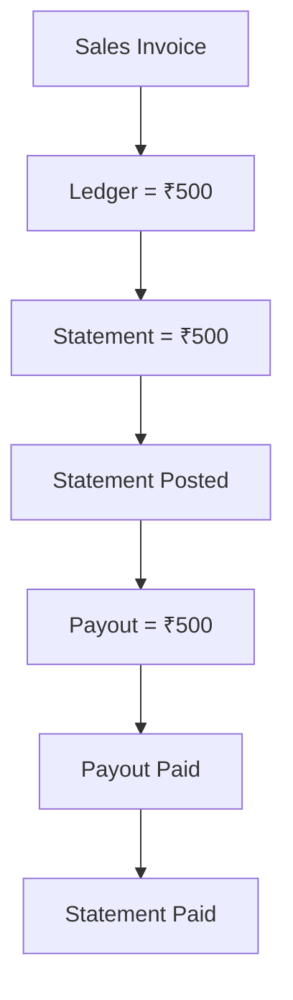

## Testing the Workspace and UI

The most important business logic should be tested at the Python/application level rather than relying only on browser interaction.

UI testing is still useful for verifying the user workflow.

Important UI scenarios include:

- creating plans
- creating rules
- creating payees
- generating statements
- moving statements through workflow
- creating payouts
- entering payment information
- marking payouts as Paid
- viewing reports

For example, the payout UI should prevent a user from marking a payout as Paid until Payment Date and Payment Reference have been supplied.

## Regression Testing

After changing calculation or workflow logic, run the relevant tests and then run the broader application test suite.

A typical progression is:

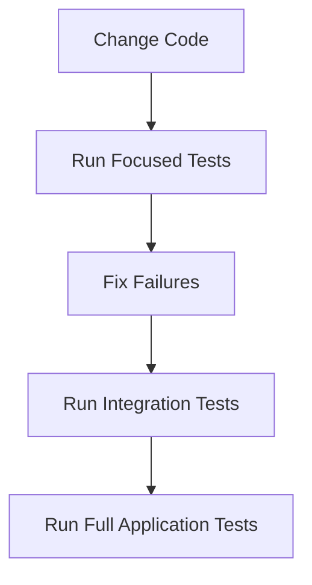

Focused tests make development faster, while the full suite helps detect regressions elsewhere in the application.

## Test Data

Tests should use clearly identifiable test records.

Names such as:

```text
Test Salesperson
Test Item
Test Commission Plan
Test Commission Rule
```

make test failures easier to understand.

For integration and end-to-end testing, an isolated test site is preferable so that unrelated ERPNext records do not interfere with the scenario.

## Known Test Environment Consideration

ERPNext test helpers can create or depend on accounting configuration such as Fiscal Years.

When running application tests on an existing development site, unrelated site data can sometimes interfere with ERPNext helper functions.

For example, an existing overlapping Fiscal Year can cause an ERPNext test fixture to fail before the application's own test logic is reached.

When a failure occurs during test discovery or setup, first determine whether the failure comes from:

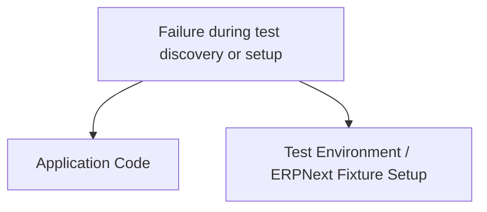

A clean or dedicated test site is useful when diagnosing this type of failure.

## Test Failure Investigation

When a test fails, identify the layer first.

```mermaid
flowchart TD
    A1[Calculation failure] --> B1[Check calculator / engine]
    A2[Resolution failure] --> B2[Check resolver / evaluator]
    A3[Ledger failure] --> B3[Check ledger / source key / immutability]
    A4[Statement failure] --> B4[Check statement resolver / statement / workflow]
    A5[Payout failure] --> B5[Check payout / payout workflow]
    A6[Event failure] --> B6[Check hooks / commission events]
    A7[Report failure] --> B7[Check report query / filters]
```

This keeps debugging focused.

## What Should Be Tested Before a Release

Before releasing a new version, verify at minimum:

### Calculation

- percentage
- fixed amount
- tiered
- Sales Team allocation
- decimal values

### Configuration

- plan selection
- plan validity
- rule matching
- rule priority
- payee resolution

### Ledger

- creation
- idempotency
- immutability
- reversal

### Statements

- generation
- eligible ledger selection
- duplicate consumption prevention
- totals
- immutability
- workflow

### Payouts

- creation
- duplicate prevention
- workflow
- payment validation
- statement synchronization

### Events

- Sales Invoice submission
- Sales Invoice cancellation

### Reports

- all six reports
- required filters
- date filtering
- expected aggregation

### End-to-End

- complete commission lifecycle from Sales Invoice to Paid payout

## Development Testing Workflow

A practical development workflow is:

```mermaid
flowchart TD
    A["1. Make a focused change"] --> B["2. Run the relevant unit tests"]
    B --> C["3. Run related integration tests"]
    C --> D["4. Perform an end-to-end check if the change affects a workflow"]
    D --> E["5. Run the full application test suite"]
    E --> F["6. Review the diff"]
    F --> G["7. Commit the change"]
```

This reduces the time spent diagnosing unrelated failures.

## Test Philosophy

The test suite should protect the application's most important business guarantees:

### Correctness

The commission amount must be calculated correctly.

### Determinism

The same transaction and configuration should produce the same result.

### Idempotency

Repeated processing should not create duplicate commissions.

### Historical Integrity

Historical commission calculations must remain stable.

### Workflow Integrity

Statements and payouts must follow their intended lifecycle.

### Traceability

A commission should be traceable from the ledger back to its source transaction and configuration.

### Reversibility

Cancelled source transactions should produce auditable reversal entries rather than destroying history.

## Next Step

Continue with [Contributing](contributing.md) to learn how to set up the development environment, make changes, run checks, and contribute changes to the project.
