<!-- File: commission-lifecycle.md -->

# Commission Lifecycle

The Incentive Compensation Engine processes commissions through a sequence of stages, starting with an ERPNext Sales Invoice and ending with a completed Commission Payout.

The complete lifecycle is:

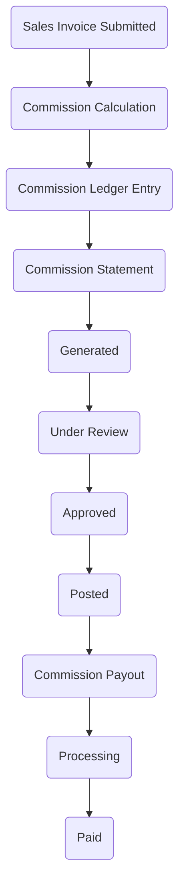

This workflow separates calculation, historical recording, review, approval, and payment into distinct stages.

## Lifecycle Overview

The main records involved are:

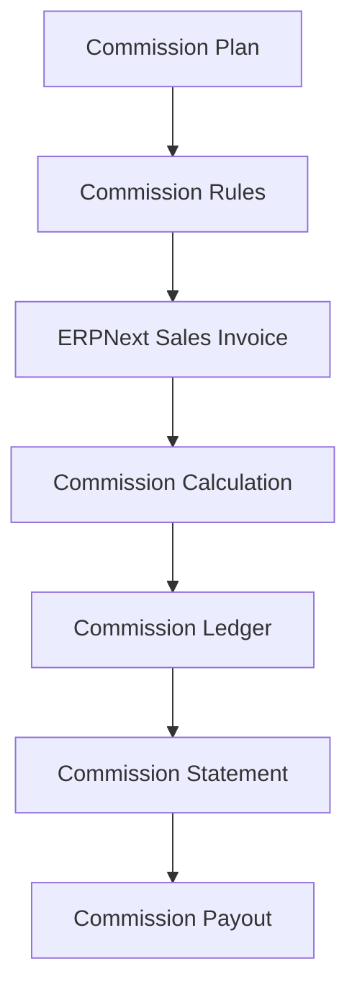

Each record has a different responsibility.

| Stage         | Record               | Purpose                                                  |
| ------------- | -------------------- | -------------------------------------------------------- |
| Configuration | Commission Plan      | Defines the overall commission context                   |
| Configuration | Commission Rule      | Defines when and how commission is calculated            |
| Configuration | Commission Payee     | Identifies who receives commission                       |
| Calculation   | Commission Ledger    | Records the calculated commission                        |
| Review        | Commission Statement | Groups eligible commissions into a period-based snapshot |
| Payment       | Commission Payout    | Tracks the actual payment                                |

## 1. Configure the Commission Plan

The first step is to configure a Commission Plan.

The plan defines:

- Company
- Currency
- Valid From
- Valid To
- Status

For example:

```text
Plan Name: Standard Sales Commission
Company:    Your Company
Currency:   INR
Valid From: 2026-10-01
Valid To:   —
Status:     Active
```

The plan establishes the context in which Commission Rules are evaluated.

## 2. Configure Commission Rules

Commission Rules are created under the Commission Plan.

A rule determines:

- what the commission applies to
- which transaction condition must match
- how the commission is calculated
- which rule takes precedence when multiple rules match

For example:

```text
Rule Name:         Demo Item Commission
Rule Applies To:   Item
Item:              Smartphone
Calculation Method: Percentage
Rate:              5%
Priority:          1
Enabled:           Yes
```

The rule is evaluated when an eligible Sales Invoice is processed.

## 3. Configure the Commission Payee

Create a Commission Payee representing the person or partner who receives the commission.

For example:

```text
Payee Name:  Test Salesperson
Payee Type:  Employee
Sales Person: Test Salesperson
Enabled:     Yes
```

The Commission Payee connects the commission system to the corresponding ERPNext Sales Person or Sales Partner.

## 4. Submit the Sales Invoice

Create and submit an ERPNext Sales Invoice.

The invoice should contain the sales transaction that can match the commission configuration.

For example:

```text
Item:       Smartphone
Quantity:   1
Rate:       ₹10,000
Amount:     ₹10,000
```

The Sales Team on the invoice identifies the Sales Person and their contribution.

For example:

```text
Sales Person: Test Salesperson
Contribution: 100%
```

When the invoice is submitted, the Incentive Compensation Engine processes the commission event.

## 5. Calculate the Commission

The commission engine evaluates the submitted Sales Invoice.

Conceptually:

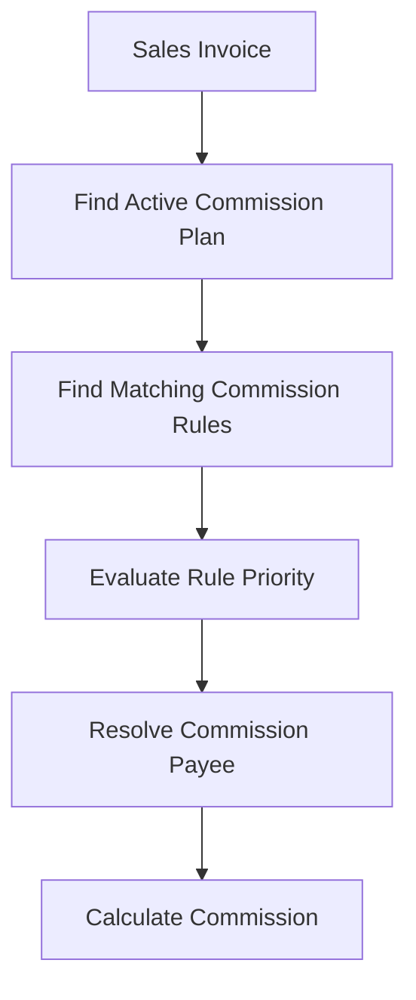

For a 5% commission on ₹10,000:

```text
Base Amount = ₹10,000
Rate        = 5%

Commission  = ₹500
```

The calculation result is then recorded in the Commission Ledger.

## 6. Create the Commission Ledger Entry

The engine creates a Commission Ledger entry containing the calculation snapshot.

For example:

```text
Sales Invoice:       ACC-SINV-2026-00021
Commission Payee:    Test Salesperson
Commission Rule:     Demo Item Commission
Commission Plan:     Standard Sales Commission
Calculation Method:  Percentage
Base Amount:         ₹10,000
Rate:                5%
Commission Amount:   ₹500
Entry Type:          Commission
Status:               Calculated
```

The ledger entry is immutable.

It preserves the historical calculation even if the Commission Plan or Rule changes later.

## 7. Create a Commission Statement

Once commission ledger entries are available, create a Commission Statement.

Select:

```text
Commission Payee
Company
Currency
From Date
To Date
```

For example:

```text
Commission Payee: Test Salesperson
Company:          Your Company
Currency:         INR
From Date:        2026-10-01
To Date:          2026-10-31
```

Save the statement.

It starts in:

```text
Draft
```

At this point, the statement has selection criteria but has not yet captured its ledger entries.

## 8. Generate the Statement

Open the saved Draft statement and click:

**Generate Statement**

The application searches for eligible Commission Ledger entries matching:

- Commission Payee
- Company
- Currency
- date range

Entries already included in another non-cancelled statement are excluded.

If eligible entries are found, the application:

1. calculates the statement totals
2. records the generation date
3. stores the selected ledger entries
4. changes the statement status to Generated

For the example:

```text
Gross Commission = ₹500
Adjustments      = ₹0
Net Commission   = ₹500
Status           = Generated
```

The generated statement is now an immutable snapshot.

## 9. Submit the Statement for Review

The Generated statement can be submitted for review.

The transition is:

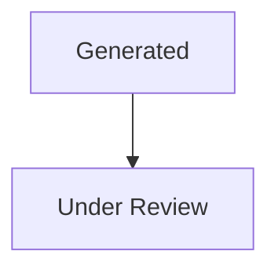

This separates the calculation stage from the review stage.

The reviewer can inspect the statement totals and included ledger entries.

## 10. Approve the Statement

Once the statement has been reviewed, approve it.

The transition is:

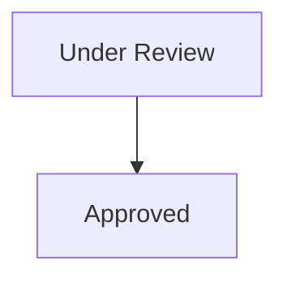

The approved statement is ready to be finalized.

## 11. Post the Statement

Post the approved statement.

The transition is:

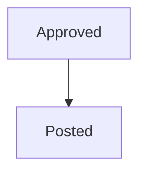

A Posted statement represents a finalized commission amount and can be used to create a Commission Payout.

## 12. Create the Commission Payout

Create a payout from the Posted statement.

The payout uses the statement's Net Commission as its amount.

For example:

```text
Statement Net Commission = ₹500
Payout Amount            = ₹500
```

The payout starts in:

```text
Pending
```

## 13. Process the Payout

Move the payout to:

```text
Processing
```

This indicates that payment processing has begun.

When the payment has actually been made, enter:

```text
Payment Date
Payment Reference
```

For example:

```text
Payment Date:      2026-10-05
Payment Reference: UTR-TEST-0001
```

Then mark the payout as Paid.

The transition is:

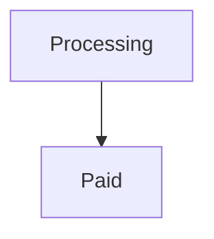

The associated Commission Statement is also marked Paid.

## Complete Example

A complete example can be represented as:

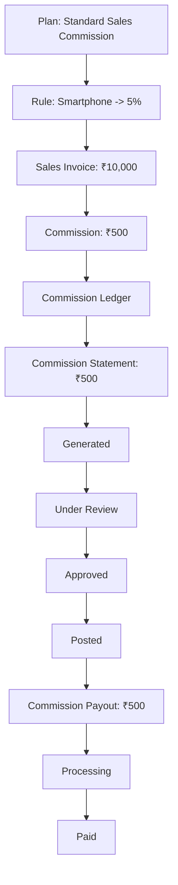

## Lifecycle State Summary

### Commission Statement

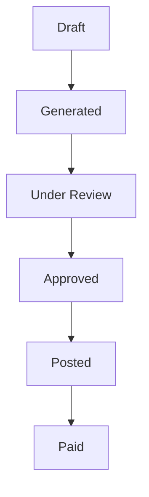

Additional cancellation paths exist from the appropriate workflow stages.

### Commission Payout

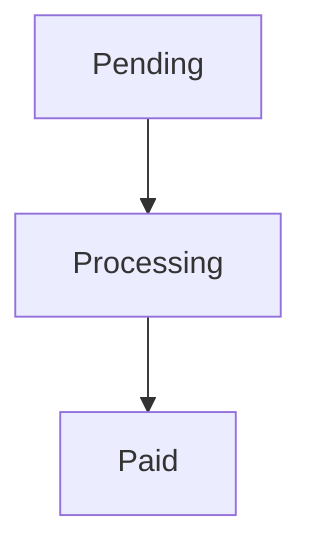

Failure and cancellation paths are also supported:

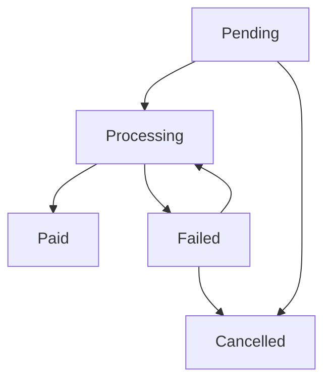

## What Happens If the Sales Invoice Is Cancelled?

A commission-generating Sales Invoice can later be cancelled.

The application does not modify the original Commission Ledger entry.

Instead, it creates a separate reversal entry.

Conceptually:

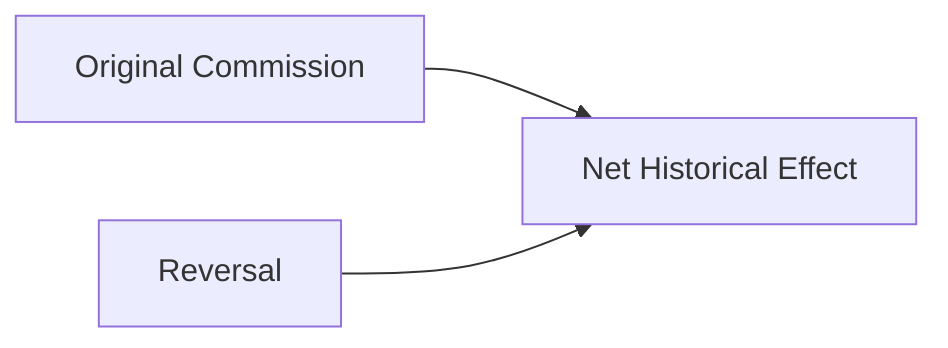

For example:

```text
Original Commission -> +₹500
Reversal            -> -₹500
```

The original commission remains part of the historical audit trail while the reversal records the effect of the cancellation.

## Why the Lifecycle Is Split Into Stages

The application deliberately separates the lifecycle into distinct records.

### Calculation

The commission engine determines what commission was earned.

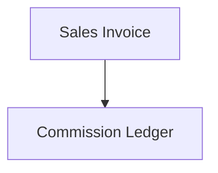

### Review

The calculated commissions are grouped into a statement for a defined period.

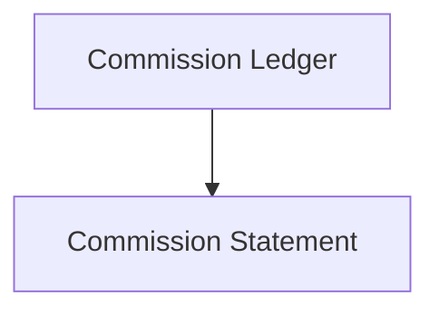

### Approval

The statement moves through review and approval before becoming Posted.

### Payment

The Posted statement becomes the basis for an actual payout.

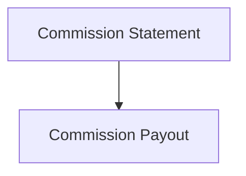

This separation provides a clear audit trail and prevents the calculation process from being confused with the payment process.

## End-to-End Audit Trail

A completed commission can be traced through the system:

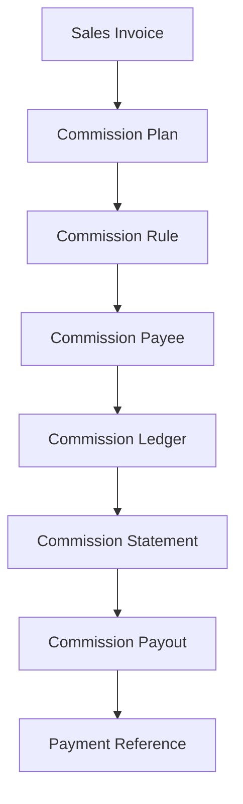

This makes it possible to start with a payment and trace it back to the commission calculation and original sales transaction.

## Next Steps

The complete lifecycle is composed of several focused workflows.

Continue with:

- [Statement Workflow](statement-workflow.md)
- [Payout Workflow](payout-workflow.md)
- [Reversals](reversals.md)
