<!-- File: payout-workflow.md -->

# Payout Workflow

A Commission Payout tracks the process of paying an approved Commission Statement.

A payout can only be created from a Posted Commission Statement and follows a controlled workflow from Pending through payment processing to Paid.

## Workflow Overview

The normal payout lifecycle is:

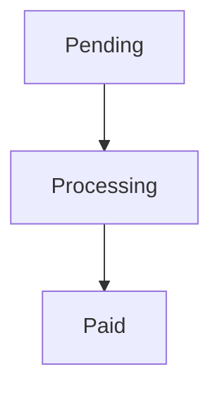

The workflow also supports payment failures and cancellation:

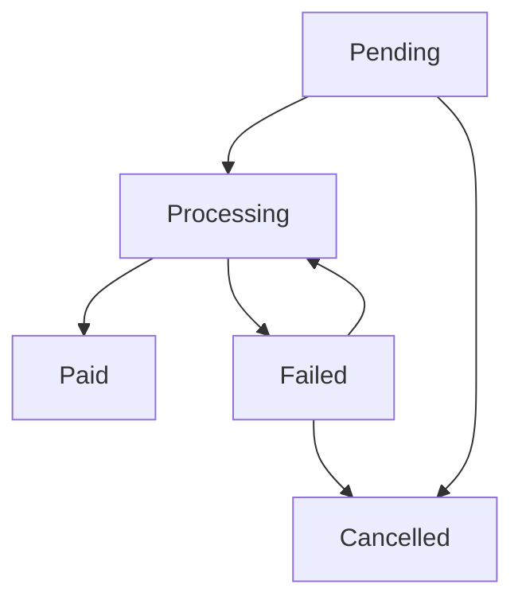

## Creating a Payout

A Commission Payout is created from a Posted Commission Statement.

For example:

```text
Commission Statement
Status:          Posted
Net Commission:  ₹5,000
```

Creating the payout produces:

```text
Commission Payout
Amount: ₹5,000
Status: Pending
```

The payout receives its key information from the statement:

- Commission Statement
- Commission Payee
- Company
- Currency
- Amount

These fields are controlled by the application.

## Pending

A newly created payout starts in:

```text
Pending
```

Pending means the payout exists but payment processing has not yet started.

The payout is associated with a Posted Commission Statement.

The next normal transition is:

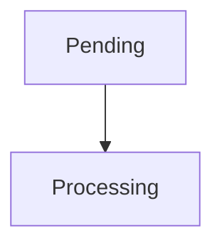

A Pending payout can also be cancelled when the payment should no longer proceed.

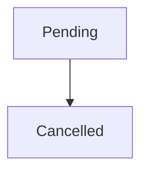

## Processing

Processing indicates that payment processing has begun.

The transition is:


While the payout is Processing, the payment has not yet been confirmed as completed.

The next possible outcomes are:

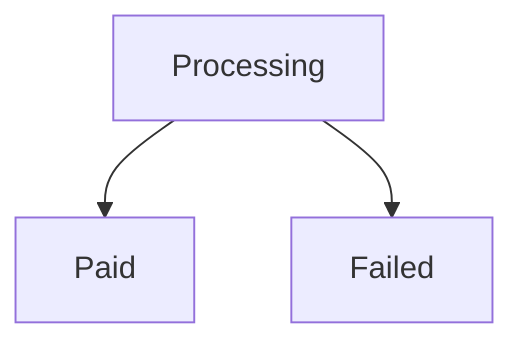

## Failed

A payout enters Failed when payment processing does not succeed.

A Failed payout can be retried:

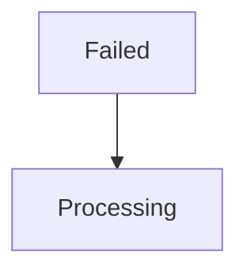

This allows the payment process to be attempted again without changing the original Commission Statement.

If the payout should no longer proceed, it can instead be cancelled:

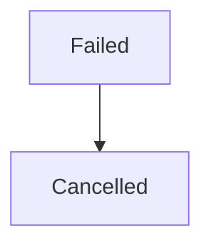

## Payment Details

A payout must contain payment information before it can be marked Paid.

The required fields are:

- Payment Date
- Payment Reference

### Payment Date

Payment Date records when the payment was made.

Example:

```text
Payment Date: 2026-10-05
```

### Payment Reference

Payment Reference identifies the actual payment transaction.

Example:

```text
Payment Reference: UTR-TEST-0001
```

The reference can be a bank transaction identifier or another payment reference used by the organization.

## Marking a Payout as Paid

A payout can be marked Paid only after the required payment information has been entered.

The application validates:

```text
Payment Date
Payment Reference
```

If Payment Date is missing, the payout cannot be marked Paid.

If Payment Reference is missing, the payout cannot be marked Paid.

Once both are provided, the payout can move from:

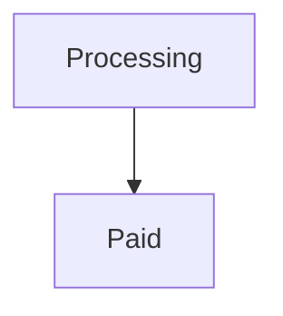

The payment fields provide a basic audit trail for the completed payment.

## Statement Synchronization

When a Commission Payout is successfully marked Paid, the associated Commission Statement is also marked Paid.

The relationship is:

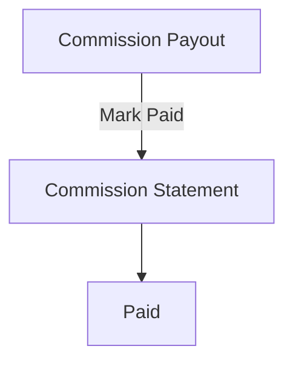

This ensures that the statement reflects the payment state of its associated payout.

The payout is responsible for the payment event; the statement records that its approved commission has been paid.

## Payout Amount

The payout amount is taken from the Commission Statement's Net Commission.

For example:

```text
Gross Commission = ₹5,500
Adjustments      = -₹500
Net Commission   = ₹5,000
```

The payout amount is:

```text
₹5,000
```

The payout does not recalculate the commission.

The calculation has already been captured in the Commission Ledger and grouped into the Commission Statement.

## One Active Payout per Statement

The application prevents multiple active payouts from being created for the same Commission Statement.

This helps prevent the same approved commission from being paid more than once.

Conceptually:

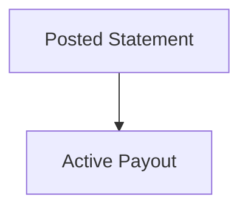

A second active payout for the same statement is not allowed.

## Cancellation

A payout can be cancelled from the workflow states where cancellation is allowed.

The supported paths are:


and:


A cancelled payout does not continue through payment processing.

The Commission Statement remains a record of the approved commission.

## Complete State Machine

The payout workflow can be represented as:

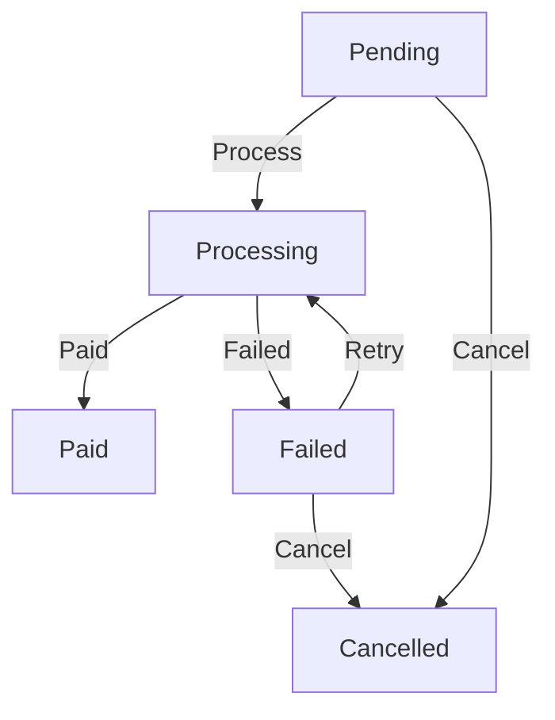

The important normal path is:


## Workflow Transitions

The payout workflow supports:

| Current Status | Allowed Next Status   |
| -------------- | --------------------- |
| Pending        | Processing, Cancelled |
| Processing     | Paid, Failed          |
| Failed         | Processing, Cancelled |
| Paid           | None                  |
| Cancelled      | None                  |

Paid and Cancelled are terminal states.

## Why Payment Is Separate From Commission Approval

Commission calculation and payment are intentionally separate.

The statement represents the approved commission:

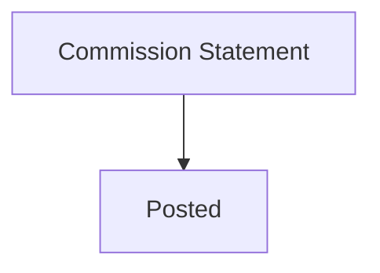

The payout represents the payment process:

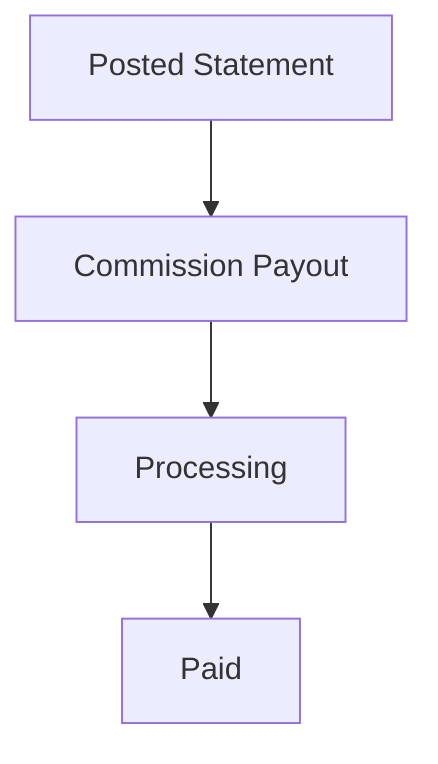

This allows an organization to distinguish between:

```text
Commission approved
```

and:

```text
Commission actually paid
```

For example, a statement can remain Posted for several days before its payout is processed.

## Example

Suppose a Posted statement contains:

```text
Commission Payee: Test Salesperson
Net Commission:   ₹500
```

Create the payout:

```text
Amount:  ₹500
Status:  Pending
```

Begin processing:


Enter:

```text
Payment Date:      2026-10-05
Payment Reference: UTR-TEST-0001
```

Mark the payout Paid:


The associated statement then becomes:

```text
Paid
```

The complete payment portion of the lifecycle is:

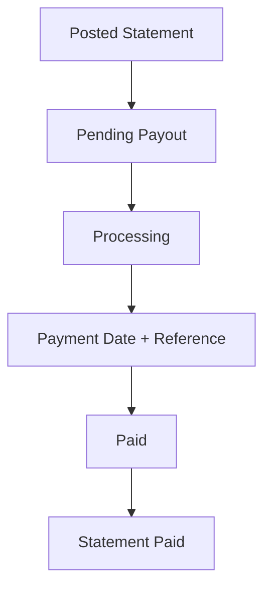

## Failed Payment Example

Suppose a payout starts processing but the payment fails.

The state becomes:

```mermaid
flowchart TD
    A[Processing] --> B[Failed]
```

The payment can then be retried:

```mermaid
flowchart TD
    A[Failed] --> B[Processing]
```

If the retry succeeds:

```mermaid
flowchart TD
    A[Processing] --> B[Paid]
```

If the payout should no longer be processed:

```mermaid
flowchart TD
    A[Failed] --> B[Cancelled]
```

The original Commission Statement and Commission Ledger remain historical records of the approved and calculated commission.

## Best Practices

### Process Only Posted Statements

Create payouts only after the Commission Statement has completed review and approval and reached Posted.

### Verify Payment Details

Before marking a payout Paid, make sure the Payment Date and Payment Reference correspond to the actual payment.

### Use Failed for Unsuccessful Payments

If a payment attempt fails, use the Failed state rather than changing the payout amount or statement.

This preserves the distinction between the approved commission and the payment attempt.

### Do Not Duplicate Payouts

Use the existing payout for the statement rather than creating another active payout for the same statement.

### Treat Paid Payouts as Historical Records

Once a payout is Paid, it represents a completed payment event.

The payment details provide the historical record of that event.

## Related Workflows

- [Commission Lifecycle](commission-lifecycle.md)
- [Statement Workflow](statement-workflow.md)
- [Reversals](reversals.md)

## Next Step

The next workflow explains what happens when a commission-generating Sales Invoice is cancelled and how the application records the resulting reversal.

Continue with [Reversals](reversals.md).
