<!-- File: statement-workflow.md -->

# Statement Workflow

A Commission Statement moves through a controlled workflow from the initial Draft configuration to final payment.

The workflow separates statement creation and calculation from review, approval, finalization, and payment.

## Workflow Overview

The normal statement lifecycle is:

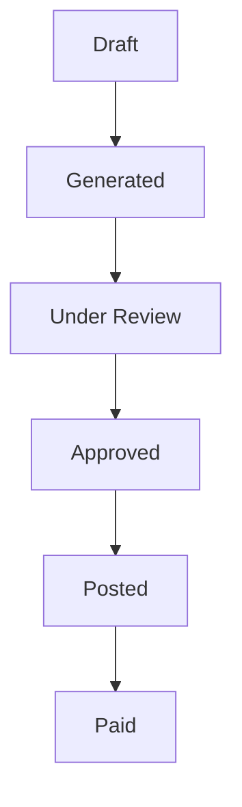

The application also supports cancellation from the appropriate workflow stages.

## Draft

A new Commission Statement starts in:

```text
Draft
```

At this stage, the statement contains the criteria used to determine which commission ledger entries should eventually be included.

The user selects:

- Commission Payee
- Company
- Currency
- From Date
- To Date

The statement does not contain its generated ledger snapshot yet.

### What You Can Do

While the statement is Draft, its selection criteria can be configured.

Save the statement before generating it.

The **Generate Statement** action is available on the saved Draft statement.

## Generate the Statement

Generation is a distinct operation from the workflow transitions.

When **Generate Statement** is executed, the application:

1. verifies that the statement is Draft
2. finds eligible Commission Ledger entries
3. calculates the statement totals
4. records the generation date
5. stores the selected ledger entries
6. changes the statement status to Generated

Conceptually:

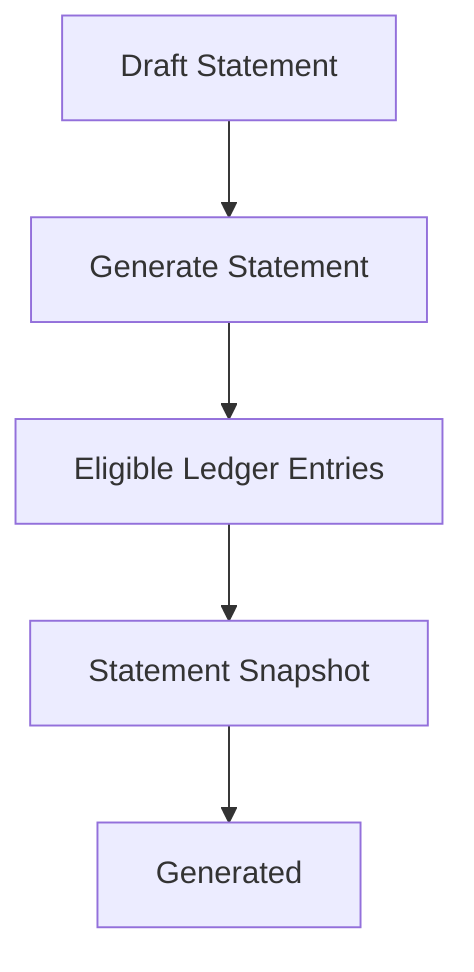

Generation is not the same as submitting the statement for review.

It creates the calculated statement snapshot first.

## Generated

A Generated statement contains:

- Gross Commission
- Adjustments
- Net Commission
- Generation Date
- Ledger Entries

The selected ledger entries are stored as part of the statement snapshot.

At this point, the statement is ready to be reviewed.

The next workflow transition is:

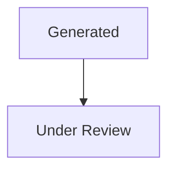

## Under Review

Under Review means the generated commission statement is being reviewed before approval.

The reviewer can inspect:

- statement totals
- included ledger entries
- source Sales Invoices
- commission amounts
- payee
- statement period

The statement should be checked for correctness before it is approved.

The allowed transitions from Under Review are:

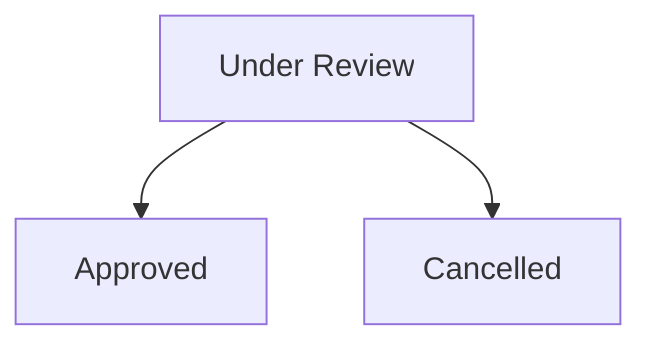

## Approved

An Approved statement has passed review.

The approved commission amount is ready to be finalized.

The allowed transitions are:

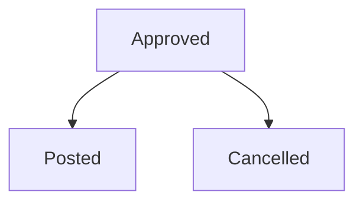

Posting finalizes the statement for payout processing.

## Posted

A Posted statement is finalized and can be used to create a Commission Payout.

The normal next step is:

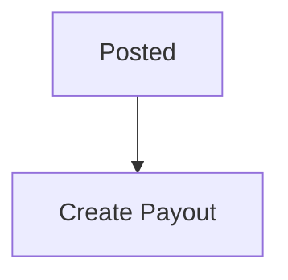

The statement itself then remains Posted until its associated payout is marked Paid.

When the payout is successfully marked Paid, the statement becomes:

```text
Paid
```

The direct statement transition is therefore:

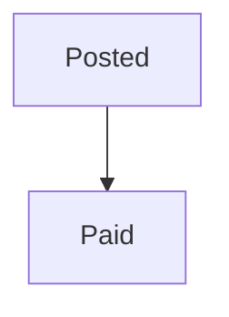

## Paid

Paid is the final successful state of the statement lifecycle.

It indicates that the associated Commission Payout has been marked Paid.

The relationship is:

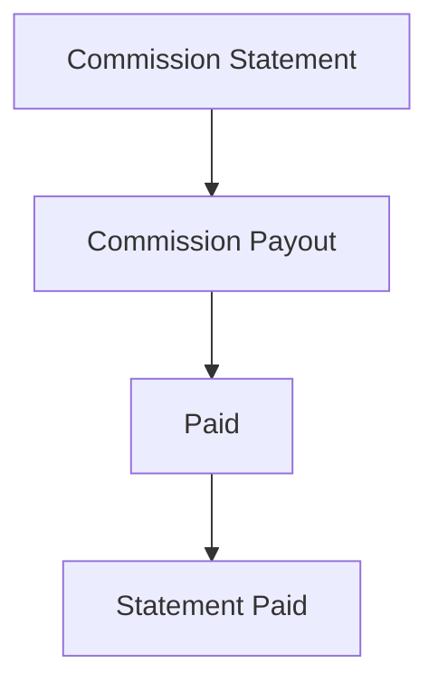

The statement does not independently process the payment.

The payout workflow is responsible for the actual payment state.

## Cancellation

Cancellation is available from the workflow stages where the statement has not yet been finalized for payment.

The supported cancellation paths are:

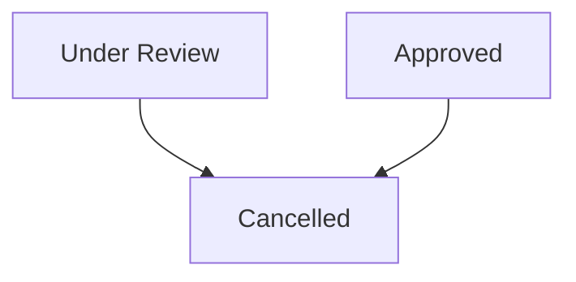

A cancelled statement does not continue through the normal approval and payout process.

## Complete State Machine

The statement workflow can be represented as:

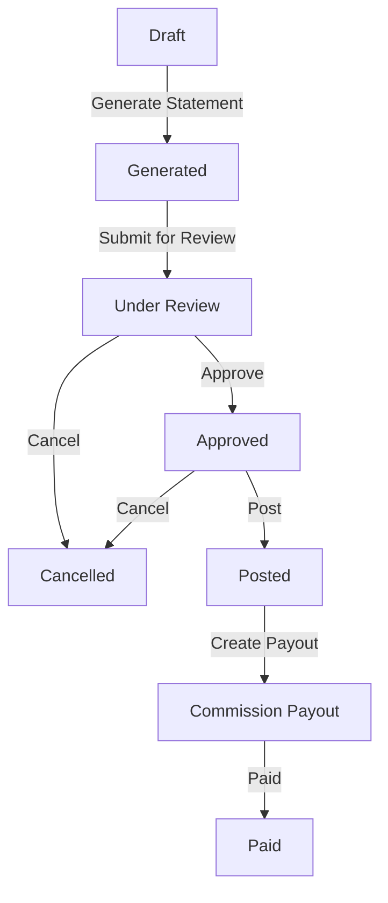

## Allowed Workflow Transitions

The application defines the following statement transitions:

| Current Status | Allowed Next Status                |
| -------------- | ---------------------------------- |
| Draft          | Generation is performed separately |
| Generated      | Under Review                       |
| Under Review   | Approved, Cancelled                |
| Approved       | Posted, Cancelled                  |
| Posted         | Paid                               |

The Draft -> Generated operation is deliberately handled by statement generation rather than the normal workflow transition mechanism.

This distinction keeps **generation** separate from **review and approval**.

## Why Generation Is Separate

Generating a statement does more than change its status.

It:

- finds eligible ledger entries
- calculates totals
- stores the ledger snapshot
- records the generation date
- creates the Generated statement

Therefore, generation is a business operation rather than a simple status change.

The application treats:

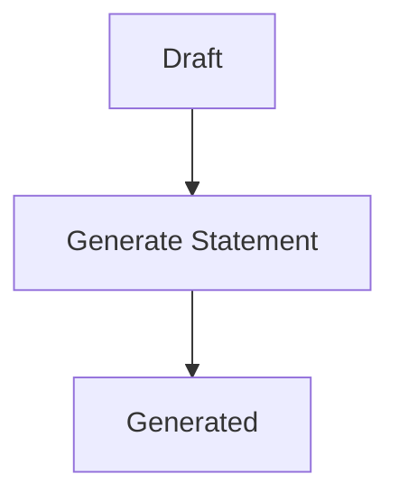

differently from:


The first creates the statement's data snapshot.

The second begins the approval workflow.

## Immutability After Generation

Once a statement has been generated, its calculation and snapshot data are protected.

The following information is locked:

- Commission Payee
- Company
- Currency
- From Date
- To Date
- Gross Commission
- Adjustments
- Net Commission
- Generation Date
- Ledger Entries

This ensures that the statement being reviewed is the same statement that was generated.

## Review Process

A typical review process is:

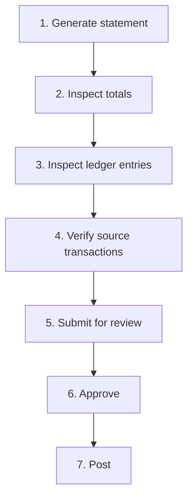

The reviewer should verify that the statement contains the expected commissions before approval.

## Posted Statements and Payouts

Posting is the point at which the statement becomes eligible for payout processing.

The flow is:

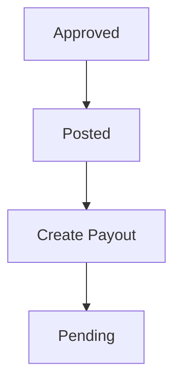

The payout then follows its own workflow.

See [Payout Workflow](payout-workflow.md) for details.

## Cancellation and Replacement Statements

If a statement is cancelled, it no longer represents an active statement consuming its selected ledger entries.

This allows eligible ledger entries to be included in a replacement statement when appropriate.

A replacement statement should be generated deliberately after confirming the correct payee, company, currency, and date range.

## Example

Suppose a salesperson has ₹5,000 of eligible commissions for October.

Create a statement:

```text
Status: Draft
Period: 2026-10-01 -> 2026-10-31
```

Generate it:

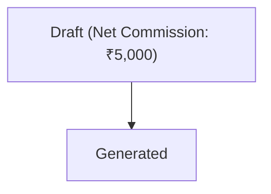

Submit it for review:


Approve it:

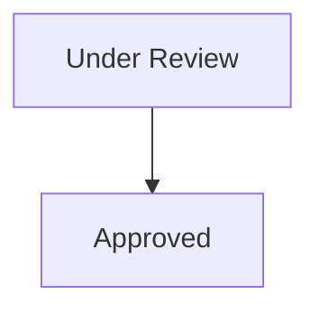

Post it:

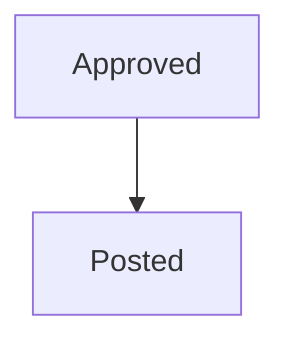

Create and pay the payout:

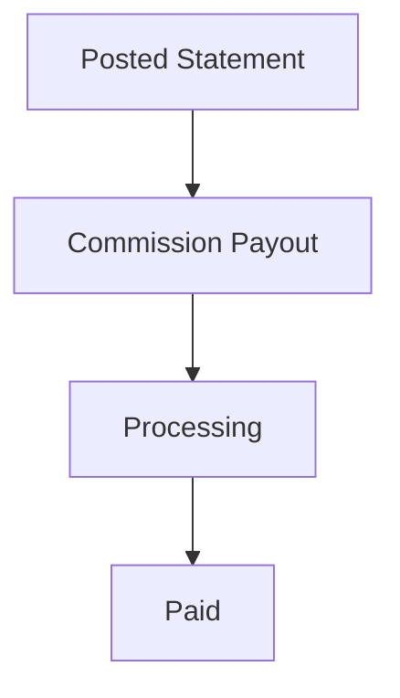

The statement then becomes:

```text
Paid
```

## Best Practices

### Generate Only After the Period Is Ready

Generation captures the eligible ledger entries available at that point.

Make sure the relevant Sales Invoices and commission calculations have been processed before generating the statement.

### Review Before Approval

Check both the totals and individual ledger entries before approving the statement.

### Do Not Bypass the Workflow

Avoid directly changing the status field.

Use the available workflow actions so that the application's transition rules are enforced.

### Treat Generated Statements as Snapshots

Once generated, the statement should be treated as historical data rather than an editable calculation.

## Related Workflows

- [Commission Lifecycle](commission-lifecycle.md)
- [Payout Workflow](payout-workflow.md)
- [Reversals](reversals.md)

## Next Step

After a statement reaches Posted, the next stage is payment processing.

Continue with [Payout Workflow](payout-workflow.md).
